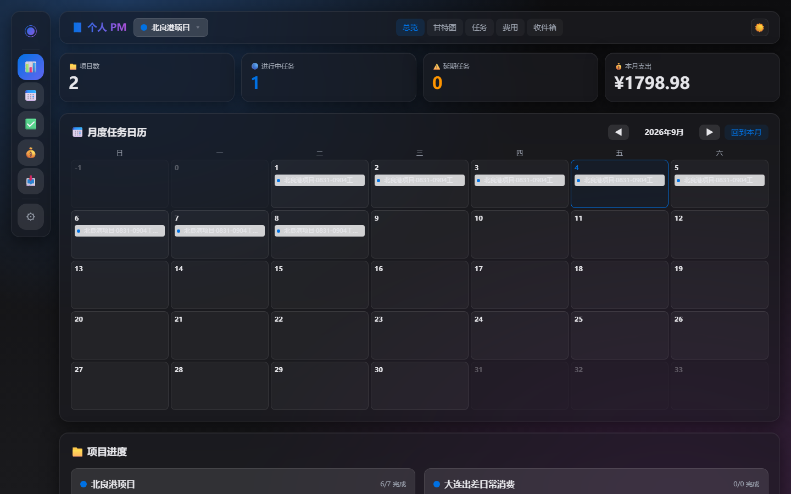
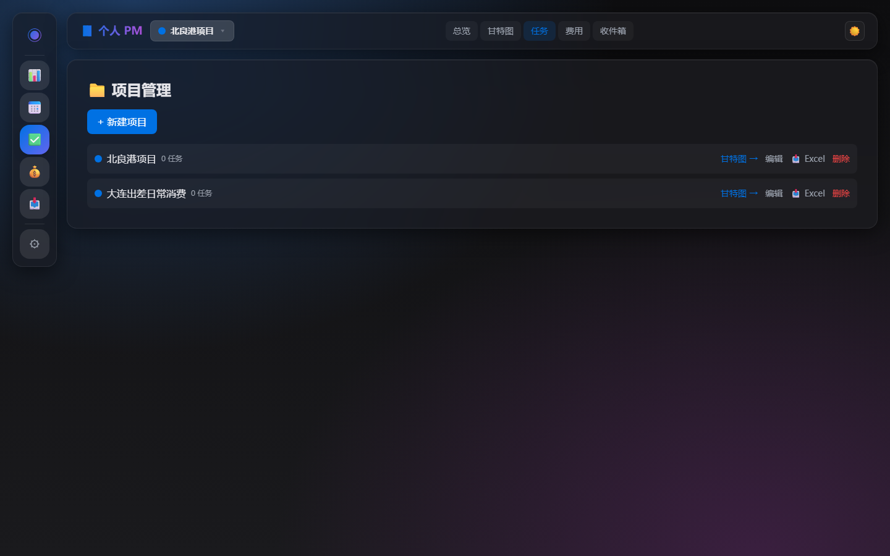
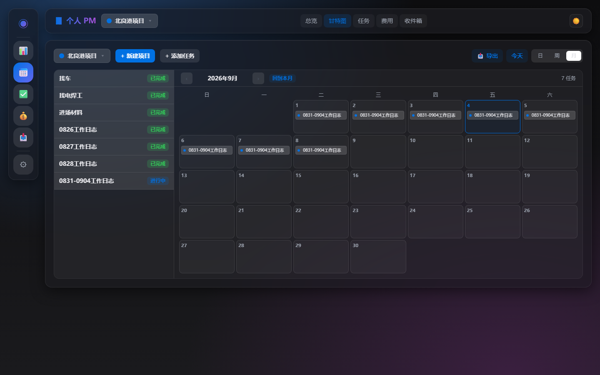
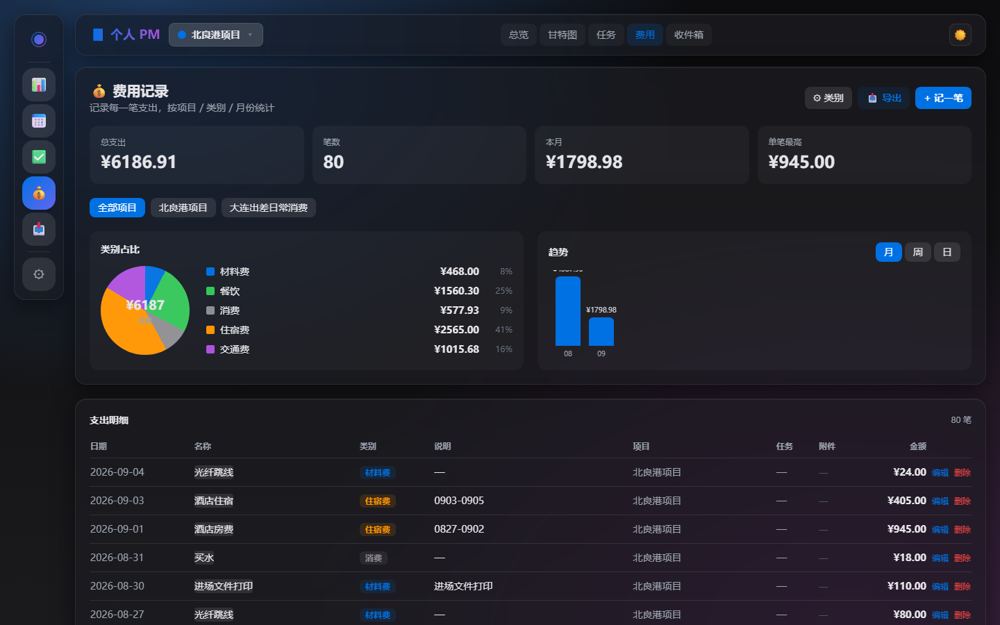
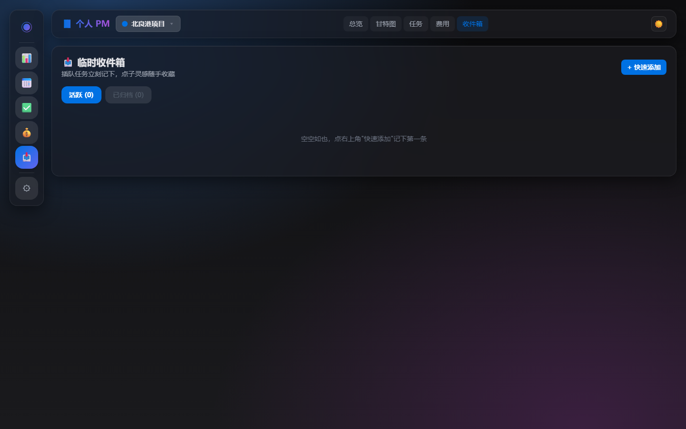
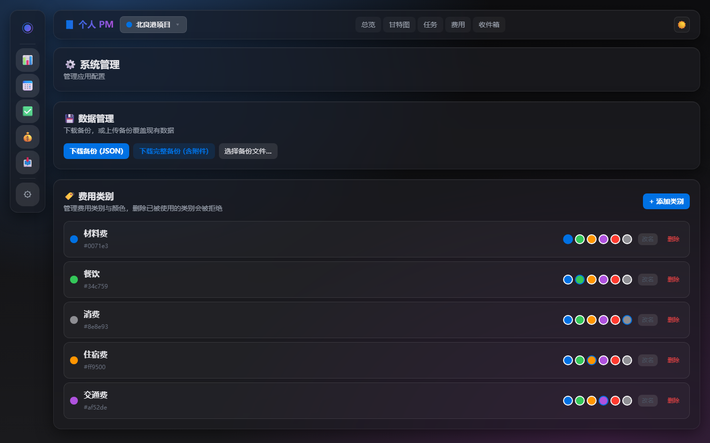

# 个人 PM (Personal PM) — 本地个人版

个人项目管理系统：项目 / 任务 / 甘特图 / 费用 / 收件箱一体化。

- 后端：FastAPI + SQLAlchemy + SQLite
- 前端：Vue 3 + Vite + Pinia + Tailwind
- 启动：Python 一键脚本 + Windows 菜单 + 单文件 exe
- 最新版本：**v0.2.0**（2026-09-04）

> ⚠️ **本仓库 2026-09 起进入维护模式**：仅修 bug、升级依赖。不再加任何需要认证/多用户/远程访问的功能。
>
> **姊妹项目** [`personal-pm-web`](https://github.com/leonkangxi-dev/personal-pm-web) — 在线多人版（VPS + Cloudflare 部署），从零起步开发。

## 截图预览

### 总览（月历 + 项目进度）



### 项目任务



### 甘特图



### 费用记录



### 临时收件箱



### 系统设置



## 功能

- 多项目管理，子任务、依赖、优先级
- 甘特图（月/周/日多视图切换）
- 任务/费用名称可点击就地编辑
- 费用分类、本月支出统计、按项目筛选
- 收件箱（随手记 → 转任务/项目）
- **附件支持**（任务/费用/收件箱，20 MB / 文件）
- **完整备份**（ZIP，含附件文件）
- **自动更新检查**（GitHub Releases API）

---

## 用户使用指南（exe 版）

适合大多数用户：下载一个 exe，双击就能用，无需装 Python/Node。

### 下载

到 GitHub Releases 页下载最新版本：

- **https://github.com/leonkangxi-dev/personal-pm/releases/latest**

每个 Release 附带两个文件：

| 文件 | 大小 | 说明 |
| --- | --- | --- |
| `PersonalPM-Setup-x.y.z.exe` | ~30 MB | 安装包，双击按向导安装（推荐初次使用） |
| `personal-pm.exe` | ~28 MB | 绿色版，无需安装，解压即用 |

> 注：绿色版此前以"拉主分支 raw 链接"的方式分发，已废弃，统一走 Releases。

### 安装

绿色版，无需安装：

1. 新建一个文件夹，比如 `D:\个人PM\`
2. 把下载的 `personal-pm.exe` 放进去
3. （可选）右键 exe → 发送到 → 桌面快捷方式
4. 完成。整个文件夹可以拷贝、备份、移动到任何位置

### 启动

**方法 1：双击**

双击 `personal-pm.exe`，控制台窗口出现后会自动打开浏览器到 http://localhost:8765 。

**方法 2：命令行启动（适合高级用户）**

打开 PowerShell 或 cmd，进入 exe 所在目录：

```
cd D:\个人PM
.\personal-pm.exe
```

### 停止

服务在前台运行时（控制台窗口打开），直接按 **Ctrl + C** 即可关闭。

如果控制台已关闭但服务还在后台：

- 打开任务管理器 → 找到 `personal-pm.exe` 或 `Personal PM` → 右键结束任务
- 或 PowerShell 执行：`Stop-Process -Name personal-pm -Force`

### 重启

**方法 1**：先停止（Ctrl+C 或结束任务），再双击 exe

**方法 2**：关掉控制台窗口再开一个新的

### 删除（卸载）

完全卸载：

1. 停止服务（Ctrl+C 或结束任务）
2. 删除整个 `个人PM` 文件夹

数据存在 exe 同级的 `data\` 子目录里，删文件夹会一起带走。如需备份：

- 启动应用，在 UI「设置 → 备份」下载 JSON 备份文件
- 或手动复制 `data\pm.db` 整个文件

### 端口

exe 默认监听 **http://localhost:8765** 。如端口被占用，请先释放 8765 端口再启动。

### 数据存储

- 数据库：`data\pm.db`（SQLite，紧挨 exe）
- 备份建议：UI「设置」页下载 JSON 备份，定期保存
- 跨电脑迁移：把 exe + data 文件夹一起拷过去，或用 JSON 备份/恢复

---

## 开发者使用指南（源码版）

适合想改代码、做二次开发的人。

### 系统要求

- **Python 3.11+**（勾选安装时 "Add to PATH"）
- **Node.js 18+**（仅开发模式需要）
- 操作系统：Windows 10/11

### 安装（开发者）

```
git clone https://github.com/leonkangxi-dev/personal-pm.git
cd personal-pm
双击 pm.bat 选 1（开发模式）或 2（单进程模式）
```

`pm.bat` 会自动建虚拟环境、装依赖、启动服务。也可命令行：

```
python start.py          # 开发模式（http://localhost:5173）
python start.py serve    # 单进程模式（http://localhost:8765）
```

### 命令行

| 命令 | 说明 |
| --- | --- |
| `python start.py` | 默认：开发模式（需 Node） |
| `python start.py serve` | 单进程模式（只需 Python） |
| `python start.py stop` | 停止 |
| `python start.py restart` | 重启 |
| `python start.py status` | 查看运行状态 |

### 数据

- 数据库：`data/pm.db`（SQLite）
- 备份：UI「设置 → 备份」下载 JSON
- 恢复：UI「设置 → 恢复」上传 JSON
- 完全重置：删除 `data/pm.db` 即可

### 项目结构

```
personal-pm/
├── backend/                FastAPI 后端
│   ├── app/                API、模型、Schema、服务
│   ├── scripts/            数据库迁移脚本
│   ├── tests/              pytest
│   ├── run_frozen.py       PyInstaller 打包入口
│   └── pyproject.toml
├── frontend/               Vue 3 前端
│   ├── src/                源码
│   ├── dist/               构建产物（其他电脑部署无需 Node）
│   └── package.json
├── dist/personal-pm.exe    单文件可执行程序（GitHub 已发布）
├── data/                   运行时数据（数据库）
├── start.py                启动/停止/重启脚本
├── pm.bat                  Windows 菜单入口
├── personal-pm.spec        PyInstaller 打包配置
├── build.py                打包脚本
└── README.md
```

### 重新打包成 exe

源码改了之后重新生成 exe：

```
backend\.venv\Scripts\pip.exe install pyinstaller
backend\.venv\Scripts\python.exe build.py
```

输出在 `dist\personal-pm.exe`（约 20 MB）。

> 注意：首次启动 1-2 秒；某些杀软可能误报 PyInstaller 出品的 exe，需要白名单。

### 端口

| 服务 | 端口 | 模式 |
| --- | --- | --- |
| 后端 FastAPI | 8765 | 全部 |
| 前端 Vite | 5173 | 仅开发模式 |

冲突处理：启动前会清理占用端口。

### 开发常用命令

```
# 后端测试
backend\.venv\Scripts\python.exe -m pytest backend\tests

# 前端构建
cd frontend && npm run build

# 端到端验收
python acceptance.py
```

### 故障排查

- **提示「网络错误，请确认后端服务已启动」**：后端挂了，先 `python start.py status` 看状态，再 `python start.py start` 拉起
- **端口 8765 占用**：`python start.py restart` 会先释放端口
- **前端白屏**：`python start.py stop` 后再 `python start.py` 重启

### 升级流程

1. 源码改动后 `git add` + `git commit` + `git push`
2. 前端有改动先 `npm run build` 再提交
3. 重新打包：`build.py` → 提交新 exe → 推送到 GitHub
4. 在 GitHub 上打 Release tag，用户下载新版本

---

## 跨电脑迁移数据

1. 旧电脑：UI「设置」下载 JSON 备份
2. 拷贝 exe（或整个文件夹）到新电脑
3. 新电脑：启动 exe，UI「设置」上传备份

或直接拷贝 `data\pm.db` 到新电脑对应位置。